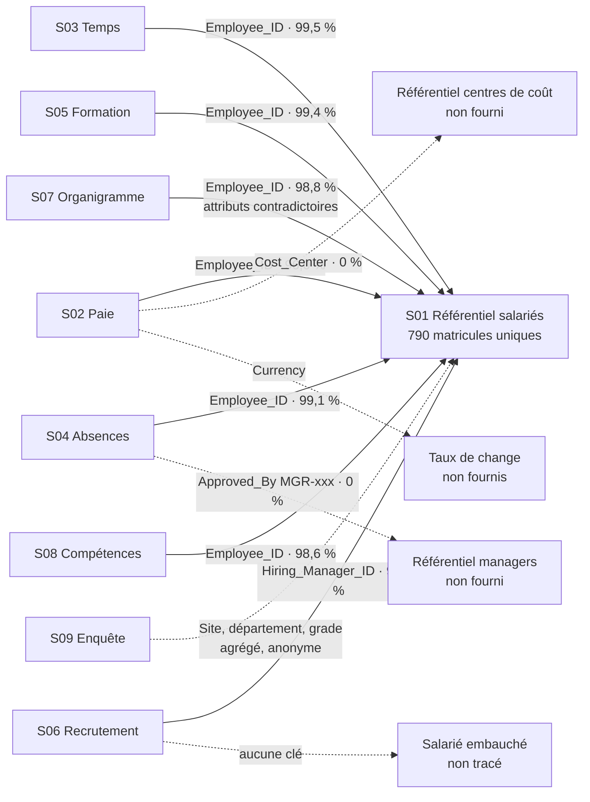

# Analyse initiale des fichiers client — Jalon 1

Équipe NomEquipe · Ressources humaines (groupe 6) · V01 du 16/10/2026

> **Statut : à relire.** Suzanne relit du point de vue des indicateurs, Hugo et Alexandre reprennent les points d'ombre dans la liste de questions. L'équipe valide ensuite les anomalies de criticité haute et les hypothèses de lecture.

## L'essentiel en 5 points

1. **Aucun des quatre indicateurs demandés par le client n'est calculable de façon fiable aujourd'hui** : effectif, masse salariale, turnover et conformité des formations. Chacun bute sur une règle que seul le client peut trancher, et pas seulement sur la qualité des données.
2. **Employee_ID relie toutes les sources au référentiel salariés**, avec 96 à 99,5 % de correspondance. Seule l'enquête fait exception, car elle est anonyme par construction. Une vision RH consolidée est donc possible.
3. **Le référentiel salariés a perdu 10 personnes.** Les lignes des matricules EMP-00761 à EMP-00770 ont été écrasées par une copie d'EMP-00101 à EMP-00110. Ces 10 personnes sont pourtant payées et présentes dans l'organigramme : c'est le cas décrit par M. Ruiz.
4. **Les 22 identifiants EXT de la paie ne sont probablement pas des externes.** Ils occupent exactement les lignes des 22 salariés du référentiel qui n'ont pas de paie : EXT-0000 en ligne 1 à la place d'EMP-00001, EXT-0037 à la place d'EMP-00038, et ainsi de suite tous les 37 rangs.
5. **Le référentiel et l'organigramme décrivent deux organisations différentes.** Ils se contredisent pour 87 % des départements, 83 % des pays et 99 % des managers. Tant qu'une source maître n'est pas désignée, aucune analyse par département n'est fiable.

## Périmètre et méthode

Le dossier client compte 15 sources : 9 fichiers de données, 4 mails et 2 PDF. Le sujet du projet (`Projet_fil_rouge.pdf`) n'en fait pas partie.

Toutes les mesures viennent du script `03_Audit_Donnees/audit_sources.py`. Il lit les fichiers en lecture seule et produit le classeur `J01_NomEquipe_RH_AuditDonnees_V01.xlsx`. Il est rejouable : relancé sur les mêmes fichiers, il redonne les mêmes chiffres. Une empreinte SHA-256 de chaque fichier figure dans l'inventaire et prouve sur quelle version l'audit a porté.

| Onglet du classeur | Contenu |
|---|---|
| Lisez-moi | Méthode, criticités, hypothèses de lecture |
| Inventaire_sources | Une fiche par source : grain, volumes, empreinte, utilité, score qualité |
| Anomalies | 142 constats chiffrés, avec exemples, impact métier, criticité et piste de correction |
| Synthese, Dimensions | Décompte par source, par criticité et par dimension qualité |
| Liens | Taux de rattachement de chaque clé au référentiel |
| Matricules_manquants | Présence des 10 matricules manquants dans les autres sources |
| Effectif | Les lectures possibles de l'effectif |
| Indicateurs | Faisabilité des 18 indicateurs candidats |
| Profil_colonnes | Profil des 86 colonnes : vides, valeurs distinctes, formats, min / max |
| Vues_synthese_client, Mails, PDF | Contenu brut des onglets de synthèse, des mails décodés et des PDF |

**Aucune donnée n'est corrigée.** Chaque correction dépend d'une règle que le client doit valider. Les pistes proposées restent des propositions.

**Criticité.** *Haute* : bloque un indicateur demandé ou crée un risque RGPD. *Moyenne* : fausse un indicateur, mais un contournement existe. *Basse* : gêne mineure ou point à documenter.

## Vue d'ensemble des sources

Le registre compte **142 anomalies** : 41 hautes, 65 moyennes et 36 basses. 114 d'entre elles appellent une réponse du client.

Le score qualité mesure la **part des lignes exploitables sans attendre le client**, c'est-à-dire touchées par aucune anomalie haute ou moyenne qui demande une réponse. Les règles manquantes et les constats de sécurité portent sur une colonne entière : ils n'entrent pas dans ce score.

| ID | Fichier | Contenu | 1 ligne = | Utilité supposée | Anomalies (hautes) | Lignes exploitables | Qualité apparente |
|---|---|---|---|---|---|---|---|
| S01 | 01_Employees_Master.xlsx | Référentiel salariés, 800 lignes, 12 colonnes | 1 salarié (en théorie) | Pivot de toutes les analyses | 16 (5) | 23 % | Faible |
| S02 | 02_Payroll_2025.csv | Paie 2025, 800 lignes | 1 salarié × 1 mois | Masse salariale, coût employeur | 16 (9) | 1,5 % | Faible |
| S03 | 03_Time_Tracking.csv | Pointages, 800 lignes | 1 pointage journalier | Heures, télétravail, journées longues | 13 (1) | 50 % | Faible |
| S04 | 04_Absenteeism.csv | Absences, 800 lignes | 1 absence | Absentéisme, motifs | 15 (3) | 23 % | Faible |
| S05 | 05_Training_History.xlsx | Formations, 800 lignes | 1 salarié × 1 formation | Conformité des certifications | 14 (3) | 35 % | Faible |
| S06 | 06_Recruitment_Pipeline.xlsx | Postes à pourvoir, 800 lignes | 1 poste | Délais, postes ouverts | 13 (1) | 30 % | Faible |
| S07 | 07_Organization_Chart.xlsx | Organigramme, 800 lignes | 1 lien hiérarchique | Structure, rattachements | 10 (3) | 0,2 % | Faible |
| S08 | 08_Skills_Matrix.xlsx | Compétences, 800 lignes | 1 salarié × 1 compétence | Cartographie des compétences | 8 (0) | 20 % | Faible |
| S09 | 09_Employee_Survey.csv | Enquête d'engagement, 800 réponses | 1 réponse anonyme | Engagement, eNPS | 6 (2) | 6 % | Faible |
| S10 | 10_mail_turnover_sales.eml | Besoin de C. Dubois | — | Définir le turnover | 2 (1) | — | Moyenne |
| S11 | 11_mail_payroll_gap.eml | Besoin de M. Ruiz | — | Rapprocher RH et Finance | 2 (1) | — | Moyenne |
| S12 | 12_mail_training_audit.eml | Besoin d'E. Schneider | — | Identifier les non-conformes | 2 (1) | — | Moyenne |
| S13 | 13_mail_comex_headcount.eml | Besoin de T. Leroy | — | Effectif gouverné | 2 (1) | — | Moyenne |
| S14 | 14_HR_Policy_GlobalTech.pdf | Politique RH multi-pays | — | Règles RH | 7 (4) | — | Faible |
| S15 | 15_Compensation_Guide_2025.pdf | Guide de rémunération | — | Grades, bonus | 7 (2) | — | Moyenne |
| TR | — | Constats transverses | — | — | 9 (4) | — | — |

Les fichiers Excel contiennent un second onglet « Vue synthèse » avec des compteurs : 47 anomalies connues, 14 budgets incohérents, 17 chaînes à investiguer, 14 certifications à revoir. Nous ne retrouvons pas ces chiffres : par exemple, nous comptons 51 embauches sur budget non approuvé, pas 14. Leur définition fait l'objet d'une question au client (D14).

## Constats par sujet métier

| Sujet | Constats chiffrés | Conséquence pour le client |
|---|---|---|
| **Effectif** (mail de T. Leroy) | 10 doublons stricts ; 10 matricules manquants ; statut actif écrit de 3 façons ; 15 « actifs » sortis le 31/12/2024 ; 57 absences longues sans règle ; aucune catégorie alternant ni externe | L'effectif va de 655 à 800 selon la lecture ; l'ETP est incalculable |
| **Masse salariale** (mail de M. Ruiz) | Un seul mois de paie par salarié sur l'année ; 22 EXT à la place de 22 salariés ; 10 salariés payés hors référentiel ; 9 bruts négatifs ; 31 devises vides ; montants autour de 5 000 quelle que soit la devise ; 56 paies après la sortie ; aucun taux de change | Masse salariale annuelle incalculable ; l'écart RH / Finance s'explique en partie par les 10 matricules manquants et les 22 EXT |
| **Turnover** (mail de C. Dubois) | 7 sorties datées en 2025 ; ni motif de sortie, ni mobilité interne, ni période d'essai, ni historique | Les chiffres de 35 %, 22 % et 18 % ne peuvent pas venir de ces fichiers |
| **Conformité des formations** (mail d'E. Schneider) | Les 7 formations sont tantôt obligatoires, tantôt optionnelles ; 264 lignes sans caractère obligatoire ; aucun poste dans les données ; 218 formations expirées au 13/01/2025, 440 au 31/12/2025 ; 13 expirations antérieures à la réalisation | Impossible d'identifier les non-conformes sans la règle par site et par poste, ni sans date de référence |
| **Absentéisme** | 3 unités (Hours, Days, jours), et les durées « Hours » sont en réalité des jours ; durées en jours calendaires ; 138 télétravails saisis comme absences ; motifs bilingues ; 17 chevauchements ; 10 fins la veille du début | Taux incalculable en l'état et gonflé par le télétravail |
| **Organisation** | Le référentiel et l'organigramme divergent sur 682 départements, 656 pays et 765 managers ; boucle hiérarchique de 9 salariés dont dépendent 15 autres ; manager fictif EMP-99999 | Aucune analyse par département fiable sans source maître |
| **Temps de travail** | 3 formats de date ; 215 dates ambiguës entre jour et mois ; 12 journées de plus de 12 h ; 18 sorties avant l'entrée ; moins de 2 pointages par salarié sur l'année | C'est un échantillon : aucun total d'heures possible |
| **Recrutement** | 209 postes pourvus ou clos sans date de clôture ; 168 postes ouverts avec une date de clôture ; 51 embauches sur budget non approuvé ; 66 postes avec plus de finalistes que de candidats ; aucun lien vers le salarié embauché | Délais non fiables ; le suivi recrutement → onboarding est impossible |
| **Engagement** | Plus de répondants que de salariés actifs sur 6 sites sur 7 (Madrid 144 %) ; 255 groupes site × département × grade sur 294 comptent moins de 5 répondants | Résultats non représentatifs et risque de réidentification |
| **Transverse** | Pas de date d'arrêté commune ; pas de référentiel de poste ; onboarding, tickets RH et règles RGPD annoncés mais absents ; libellés en 3 langues ; 5 conventions de date | Plusieurs indicateurs du cahier des charges n'ont aucune source |

## Effectif : les lectures possibles

Selon la définition retenue, l'effectif varie de **655 à 800**. Ce tableau répond factuellement au mail de T. Leroy ; le choix de la définition revient au client (question M03).

| Lecture | Valeur | Source | Remarque |
|---|---|---|---|
| Lignes du référentiel | 800 | S01 | Contient 10 doublons stricts |
| Matricules uniques du référentiel | 790 | S01 | Tous statuts, sortis compris |
| Personnes connues (référentiel + 10 manquants) | 800 | S01, S07 | Les 10 manquants figurent dans l'organigramme et la paie |
| Lignes de paie 2025 (EMP + EXT) | 800 | S02 | 22 EXT de nature inconnue |
| Matricules EMP payés en 2025 | 778 | S02 | Dont 10 absents du référentiel |
| Actifs + absences longues (Leave) | 726 | S01 | Inclusion de Leave à trancher |
| Actifs + Leave, sans sortie, + 10 manquants | 721 | S01, S02 | Hypothèse haute de personnes présentes |
| Statut actif (Active, Actif, ACTIVE) | 670 | S01 | 3 graphies regroupées |
| Actifs sans date de sortie | 655 | S01 | Exclut les 15 « actifs » sortis le 31/12/2024 |
| ETP | Non calculable | — | Aucun temps de travail contractuel |

## Carte des liens entre fichiers

Le référentiel salariés (S01) est le pivot. Chaque flèche porte la clé utilisée et le pourcentage de valeurs effectivement rattachées.

| Statut du lien | Liens concernés | Signification |
|---|---|---|
| Fiable | Temps, absences, formation | Les seuls orphelins sont les matricules manquants |
| Partiel | Paie, compétences, recrutement, organigramme | Orphelins plus nombreux ou attributs contradictoires |
| Absent | Managers MGR-xxx, centres de coût, taux de change, salarié embauché | La clé existe, mais le référentiel cible n'a pas été fourni |
| Agrégé | Enquête | Aucun identifiant, par anonymat ; pays, sites, départements et grades correspondent au référentiel |

Le détail des 12 liens mesurés figure dans l'onglet *Liens*. La présence de chacun des 10 matricules manquants dans les autres sources figure dans l'onglet *Matricules_manquants* : chacun apparaît dans 3 à 6 sources, toujours dans la paie et l'organigramme.

## Indicateurs : ce qui est calculable aujourd'hui

Des 6 indicateurs RH du cahier des charges, aucun n'est calculable de façon fiable. Sur 18 indicateurs candidats, 4 sont faisables, 7 partiellement et 7 pas du tout. Le détail figure dans l'onglet *Indicateurs* du classeur. C'est le point de départ de la matrice indicateurs × sources de Suzanne.

| Indicateur | Demandé | Calculable | Ce qui bloque |
|---|---|---|---|
| Effectif | Oui | Partiellement | Définition ; doublons ; 10 manquants ; statuts |
| ETP | Oui (COMEX) | Non | Aucun temps contractuel |
| Turnover | Oui | Non | Ni motif, ni mobilité, ni historique |
| Absentéisme | Oui | Non | Unités, télétravail, jours théoriques |
| Délai de recrutement | Oui | Partiellement | 209 clôtures sans date |
| Onboarding, tickets RH | Oui | Non | Sources non fournies |
| Masse salariale | Mail Finance | Non | 1 mois par salarié, devises, taux de change |
| Conformité formations | Mail audit | Non | Règle par site et poste, date de référence |
| Ancienneté, journées > 12 h, écart d'évaluation, score qualité | Non | Oui | Date de référence à fixer |

## Hypothèses de lecture à valider

Pour mesurer les anomalies, le script a dû interpréter certaines valeurs. Ces interprétations ne sont appliquées à aucun fichier.

- **Formats de date lus colonne par colonne.** Les dates JJ/MM/AAAA sont lues jour en premier. C'est confirmé par les données : par exemple, 500 débuts d'absence ont un premier nombre supérieur à 12, et aucun n'en a un second. Les pointages mêlent trois formats et sont lus dans l'ordre ISO, puis jour en premier, puis mois en premier.
- **Dates de référence provisoires** : 13/01/2025, date des mails, et 31/12/2025, fin de la période de paie.
- **Synonymes** : Active = Actif = ACTIVE pour le statut. Les 10 doublons du référentiel sont ignorés dans les croisements.
- **Devise attendue par pays** : EUR pour la France, l'Espagne et l'Allemagne ; CLP pour le Chili ; CNY pour la Chine ; PLN pour la Pologne.
- **Employee_ID** est la clé commune. Anonymous_Key n'est pas utilisée.

## Comparaison avec la version précédente (V03 du Drive)

L'équipe avait produit une première analyse (V03, 112 anomalies). Cette V01 a été refaite de zéro, avec un nouveau script, puis comparée à la V03. La plupart des chiffres concordent : 10 doublons, 10 manquants, 22 EXT, 9 bruts négatifs, 31 devises vides, effectif de 670 à 800, divergences de l'organigramme, 218 formations expirées, 138 télétravails, 66 postes à plus de finalistes que de candidats, 51 embauches hors budget. **Quatre chiffres de la V03 étaient faux ou mal interprétés :**

| Constat | V03 | V01 | Explication |
|---|---|---|---|
| Absences dont la fin précède le début | 153 | **10** | Le début est au format JJ/MM/AAAA. Avec cette lecture, seules 10 absences finissent avant de commencer, toujours la veille. La V03 a probablement lu une partie des dates mois en premier. |
| Recrutements clôturés avant l'ouverture | 30 | **0** | Même cause : 483 dates d'ouverture ont un premier nombre supérieur à 12, donc le jour est en premier. |
| Pointages aux dates ambiguës | 394 | **215** | Les 394 dates de la V03 sont les dates au format barre oblique qui ne sont pas forcément jour en premier. Parmi elles, 179 sont forcément mois en premier (second nombre supérieur à 12) : elles sont lisibles. Seules 215 sont réellement ambiguës. |
| Identifiants EXT | « Externes ? » | **Matricules probablement écrasés** | Les 22 EXT occupent exactement les lignes des 22 salariés sans paie. |

La V01 ajoute aussi des constats absents de la V03 :

- l'unité « Hours » des absences correspond en réalité à des jours ;
- les durées d'absence sont en jours calendaires ;
- 56 paies sont versées après la sortie ;
- la devise du référentiel est incohérente avec le pays pour 603 lignes ;
- le salaire ne dépend pas du grade ;
- 17 absences se chevauchent, et 27 absences approuvées n'ont pas d'approbateur ;
- 13 certifications expirent avant leur délivrance, et 201 formations « In progress » ont une date de réalisation ;
- aucun référentiel de poste n'existe ;
- les 9 fichiers font exactement 800 lignes.

**Recommandation : remplacer la V03 par cette V01** et la noter dans le journal des décisions.

## Informations manquantes

Les sources annoncées par le cahier des charges du groupe 6 ne correspondent pas toutes au dossier reçu :

| Annoncé dans le cahier des charges | Reçu |
|---|---|
| employees_anonymized.xlsx | 01_Employees_Master.xlsx, non anonymisé (matricule et clé anonyme côte à côte) |
| absence_records_2025.csv | 04_Absenteeism.csv |
| recruitment_pipeline.xlsx | 06_Recruitment_Pipeline.xlsx |
| organization_structure.xlsx | 07_Organization_Chart.xlsx |
| onboarding_checklist.pdf | **Non reçu** |
| hr_tickets_extract.csv | **Non reçu** |
| mail_hr_director_dashboard.msg | **Non reçu** ; 4 autres mails reçus |
| gdpr_access_rules.pdf | **Non reçu** ; la politique RH n'en traite qu'en partie |
| — | Reçus en plus : paie, temps, formation, compétences, enquête, guide de rémunération |

Manquent aussi : une date d'arrêté, des taux de change, les référentiels des centres de coût, des managers MGR-xxx, des sites et des postes, ainsi que l'historique des mouvements (entrées, sorties, mobilités).

## Suite

- Les 114 anomalies qui attendent une réponse du client sont reprises dans `02_Besoins_Metier/J01_NomEquipe_RH_QuestionsClient_V01.md` (42 questions, dont 14 bloquantes).
- Le registre servira de base aux contrôles qualité du jalon 3 et à la page qualité du tableau de bord.
- Dès que le client répond, ses réponses seront intégrées au script, qui produira une V02 du registre.
